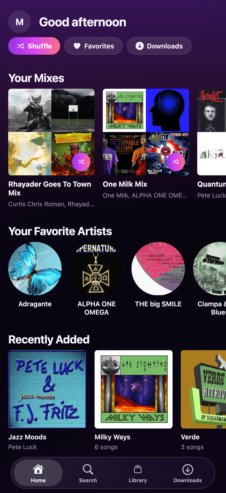
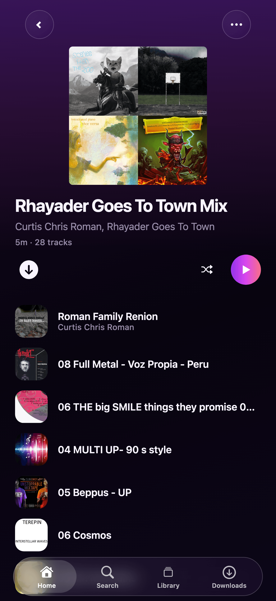
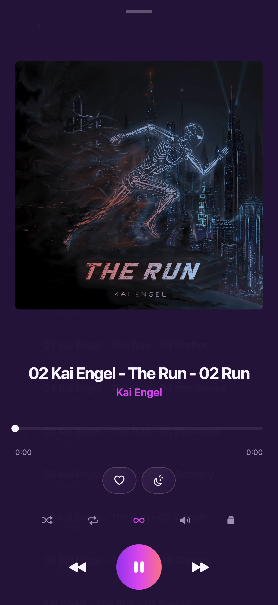
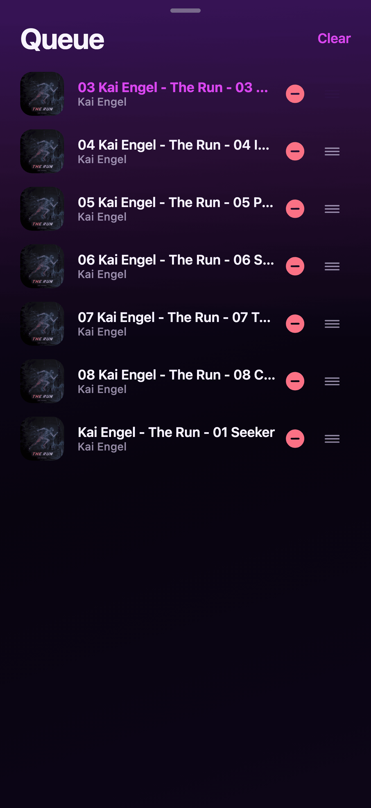
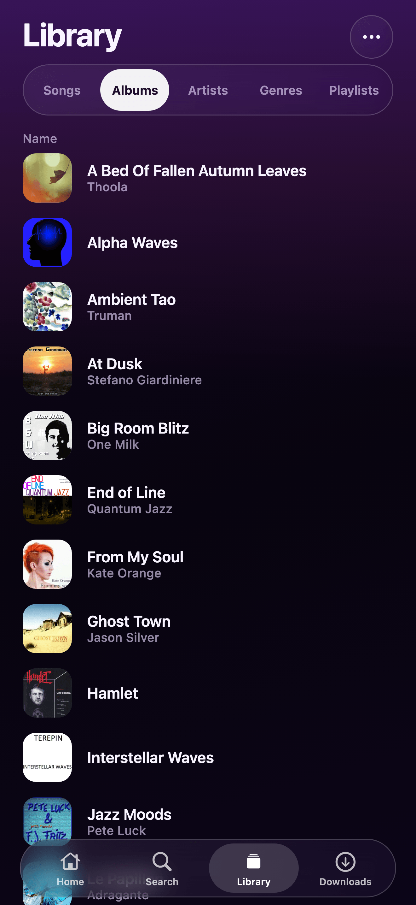
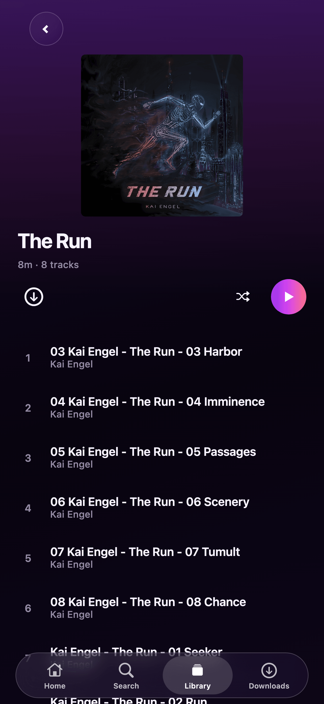
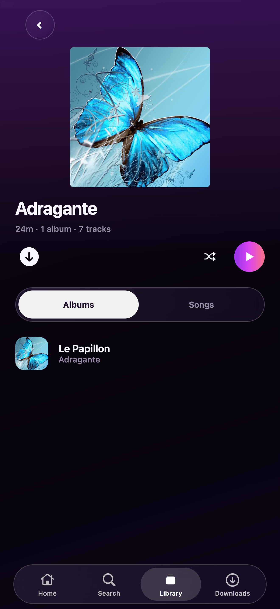
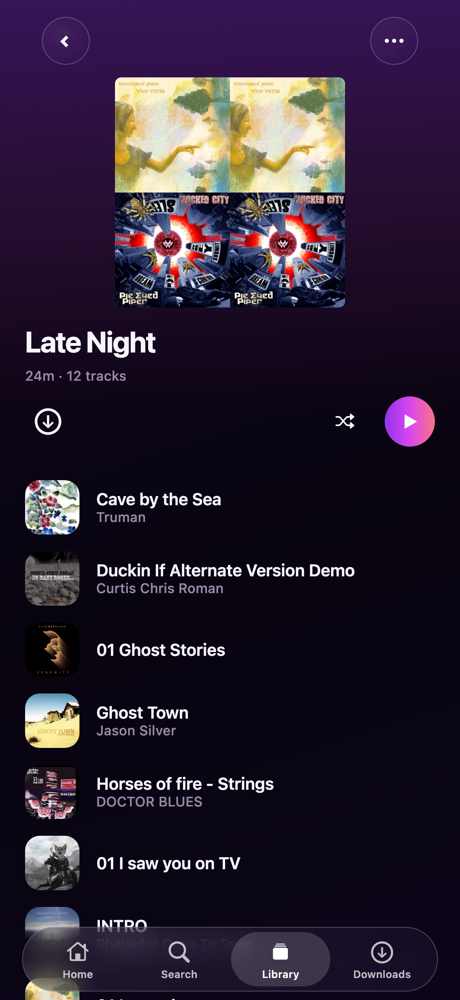
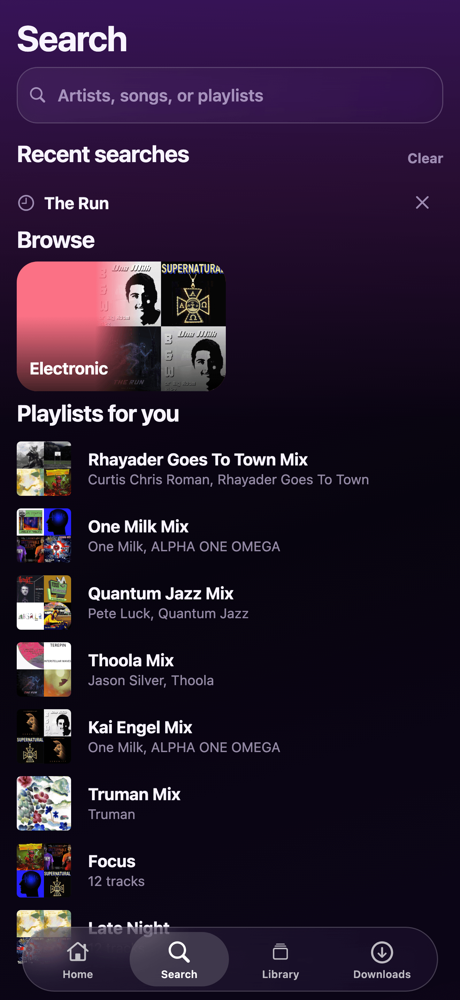
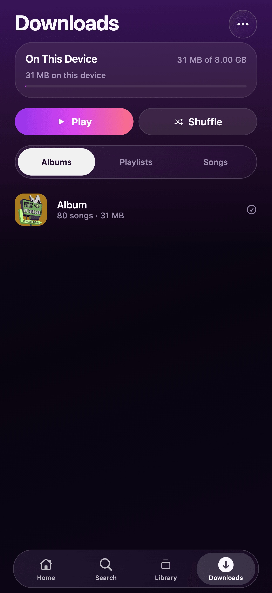

<p align="center">
  
</p>

<h1 align="center">Melofin</h1>

<p align="center">
  <strong>Your Jellyfin library, tuned for iPhone.</strong><br />
  Offline-first music player.
</p>

<p align="center">
  <a href="https://github.com/kgrubb/melofin/actions/workflows/ci.yml"></a>
  <a href="https://github.com/kgrubb/melofin/actions/workflows/release.yml"></a>
  <a href="LICENSE"></a>
  <a href="https://github.com/sponsors/kgrubb"></a>
  
</p>

---

Melofin is a Jellyfin music client for iPhone. Browse your library, queue tracks, download for the commute, cast to speakers, and keep listening when the network flakes out.

## Screenshots

| Home | Mix |
| :---: | :---: |
|  |  |

| Now playing | Queue |
| :---: | :---: |
|  |  |

| Library | Album |
| :---: | :---: |
|  |  |

| Artist | Playlist |
| :---: | :---: |
|  |  |

| Search | Downloads |
| :---: | :---: |
|  |  |

## Features

| | |
|:--|:--|
| **Library** | Albums, artists, playlists, genres, favorites, and search. Sort and filter without the app bogging down. |
| **Playback** | Gapless playback, optional crossfade, and lock screen controls. |
| **Offline** | Download albums and playlists. Keep listening on a plane or a dead VPN. Listens catch up when you reconnect. |
| **Home** | Continue listening, Instant Mixes, favorites, and Your Mixes. |
| **Cast** | AirPlay, Chromecast, or another Jellyfin session. |
| **Also** | Lyrics, ReplayGain, a sleep timer, Autoplay, and more than one server. |

## Requirements

- macOS Tahoe with **Xcode 26.5+** (Expo SDK 57 / Liquid Glass / iOS 26 SDK)
- **Node 24** (see `.nvmrc`)
- CocoaPods
- An Apple Developer account
- A Jellyfin server (password, Quick Connect, or SSO)

## Quick start

```bash
git clone https://github.com/kgrubb/melofin.git
cd melofin
npm ci

npx expo prebuild --clean --platform ios
npx expo run:ios
npx expo start --dev-client
```

Or open `ios/Melofin.xcworkspace` in Xcode after prebuild.

### EAS

Development client:

```bash
npm i -g eas-cli@latest
eas login
eas build -p ios --profile development
npx expo start --dev-client
```

Production iOS builds run from the [Release](https://github.com/kgrubb/melofin/actions/workflows/release.yml) workflow after a version tag is cut. Set `EXPO_TOKEN` on the repo. To submit to App Store Connect as well, add `EXPO_ASC_API_KEY_ID`, `EXPO_ASC_API_KEY_ISSUER_ID`, and `EXPO_ASC_API_KEY_P8`.

EAS Update is off for v1.

## Releases

Merges to `main` open a `[release vX.Y.Z]` PR from conventional commit titles (`feat` / `fix` / `perf` / breaking). Merging that PR tags the version, writes the changelog, publishes a GitHub Release, and kicks off the EAS production iOS build. See [CONTRIBUTING.md](./CONTRIBUTING.md#releases).

## CarPlay

CarPlay Audio (`com.apple.developer.carplay-audio`) is always on for iOS builds. The entitlement must stay enabled on App ID `app.melofin.player`. After native config changes, run `npx expo prebuild --platform ios` and rebuild.

## Development

```bash
npm run lint
npm run typecheck
npm run test:coverage
```

See [CONTRIBUTING.md](./CONTRIBUTING.md) for the full checklist and offline smoke notes.

## Docs

| Doc | What it covers |
| --- | --- |
| [CHANGELOG.md](./CHANGELOG.md) | What shipped (written by CI) |
| [CONTRIBUTING.md](./CONTRIBUTING.md) | How to land a change, including conventional PR titles |
| [PRIVACY.md](./PRIVACY.md) | App Store / in-app privacy policy |

## Contributing

Issues and PRs are welcome. See [CONTRIBUTING.md](./CONTRIBUTING.md) for setup, conventions, and the PR checklist.

## License

[GPL-3.0](./LICENSE) with an App Store additional permission © Melofin contributors

Melofin is free software: you can redistribute it and/or modify it under the terms of the GNU General Public License as published by the Free Software Foundation, version 3. App Store distribution is allowed under the additional permission in [LICENSE](./LICENSE). Source is this repository.
